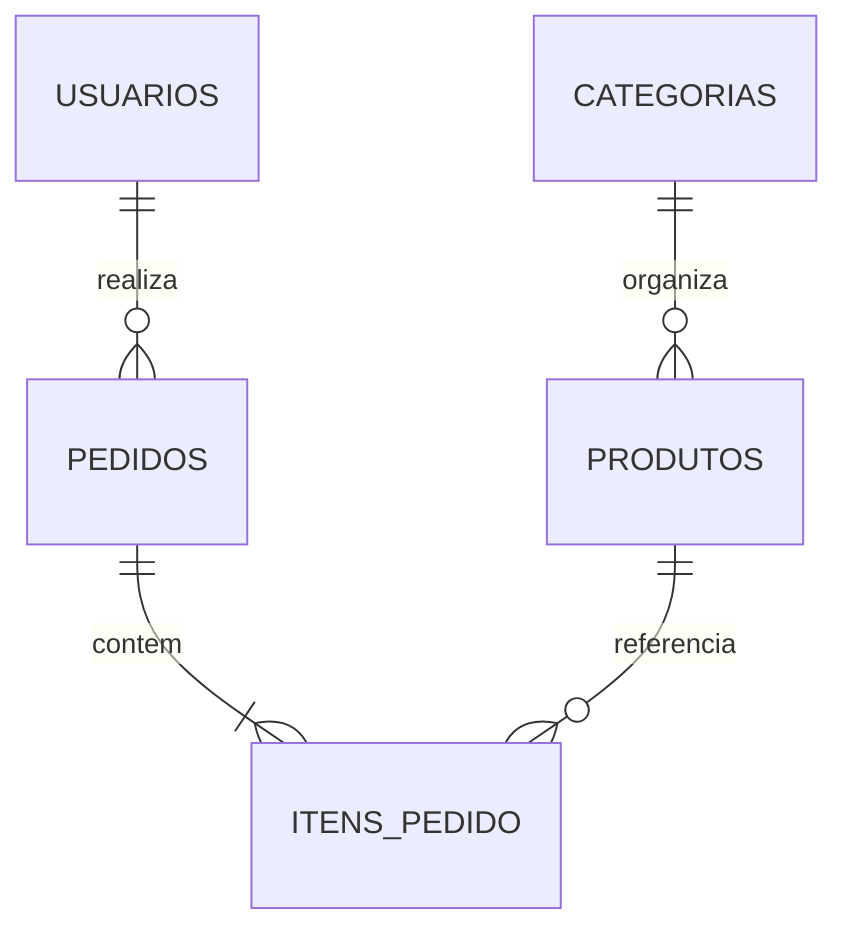

# Banco de dados — Doppio Mocha

Banco: `doppio_mocha` (MySQL, codificação utf8mb4).

## Dicionário de dados

| Tabela | Campos principais | Finalidade |
|---|---|---|
| usuarios | id, nome, email, senha, criado_em | Cadastro e autenticação; senha guarda hash. |
| categorias | id, nome | Agrupamento de produtos. |
| produtos | id, categoria_id, nome, descricao, preco, imagem, estoque, ativo | Cardápio e disponibilidade. |
| pedidos | id, usuario_id, total, metodo_pagamento, status, criado_em | Cabeçalho do pedido realizado pelo cliente. |
| itens_pedido | id, pedido_id, produto_id, nome_produto, quantidade, preco_unitario | Itens e valores registrados no momento do pedido. |

## Relacionamentos
- Uma categoria pode possuir vários produtos; cada produto pode pertencer a uma categoria.
- Um usuário pode realizar vários pedidos; cada pedido pertence a um usuário.
- Um pedido possui vários itens de pedido.
- Um item pode referenciar um produto; o nome e preço são copiados para preservar o registro histórico.

## DER (Mermaid)

O script de criação e carga inicial está em `database/doppio_mocha.sql`.
