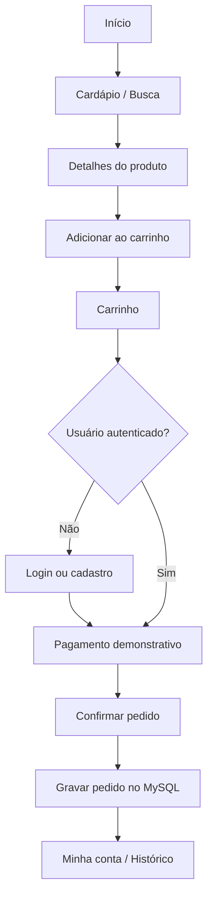

# Telas e fluxos — Doppio Mocha

- **Início (`html/index.php`)**: apresentação da cafeteria e produtos em destaque.
- **Cardápio (`html/produtos.php`)**: catálogo, categorias e busca.
- **Detalhes (`html/detalhes_produto.php`)**: descrição, preço e disponibilidade.
- **Login/cadastro (`html/login.php`, `html/cadastro.php`)**: autenticação e criação de conta.
- **Carrinho (`html/carrinho.php`)**: itens, quantidades, remoção e total.
- **Pagamento (`html/pagamento.php`)**: escolha demonstrativa do método e confirmação.
- **Minha conta (`html/painel.php`)**: histórico de pedidos e saída.

## Fluxo principal

